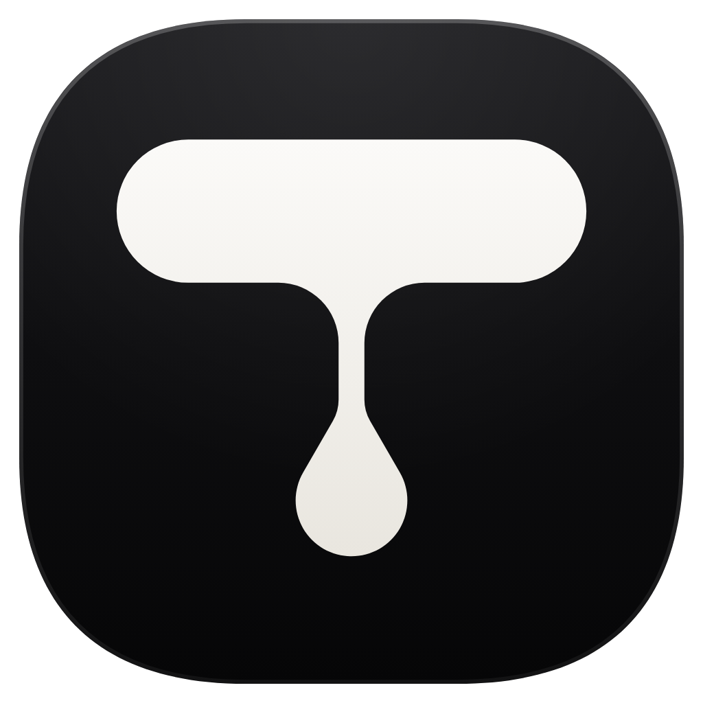
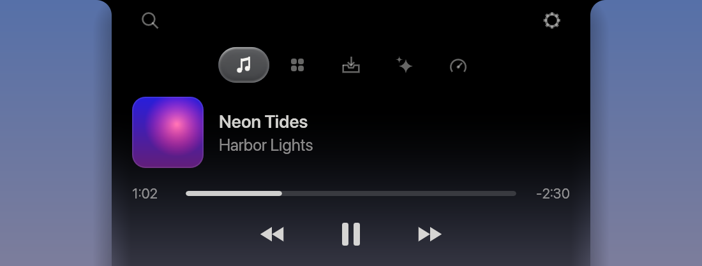
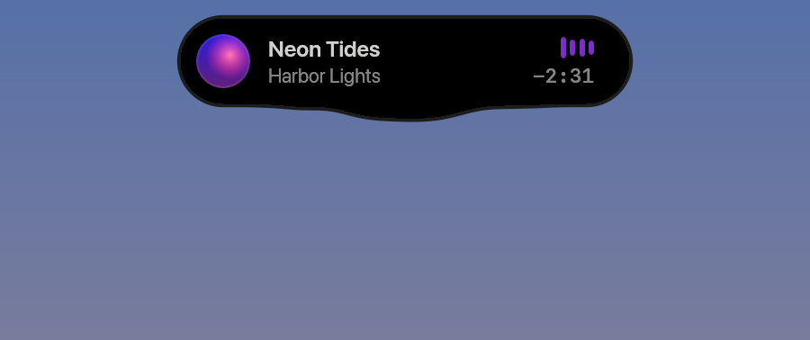
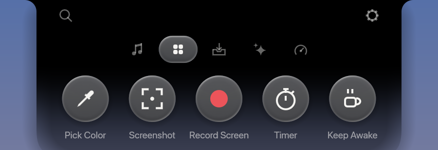
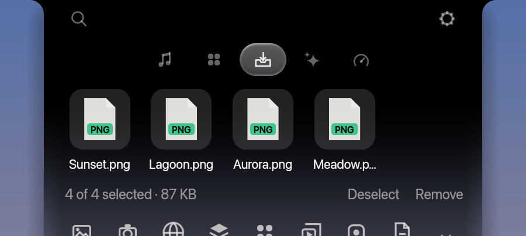
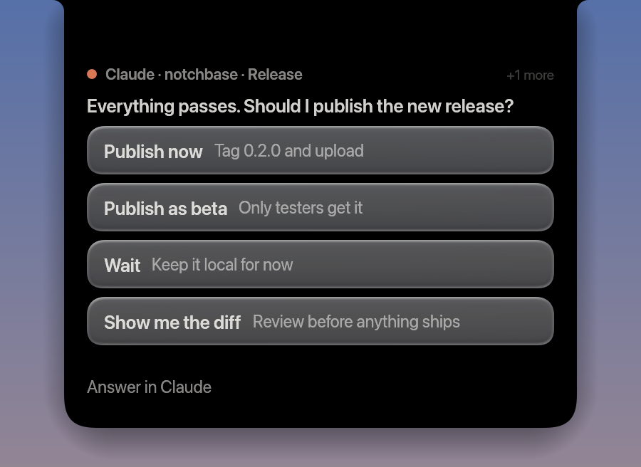
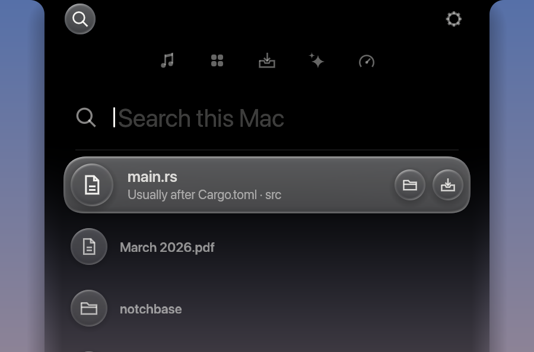
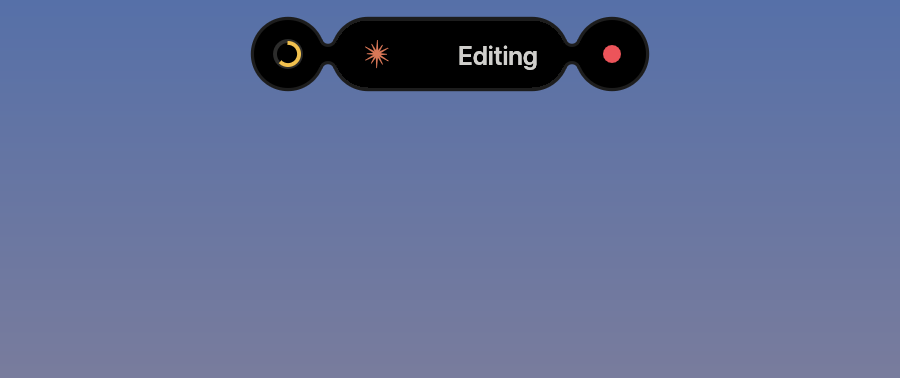

  

<h1 align="center">notchbase</h1>

  <strong>A fluid notch for macOS and Windows that actually does things.</strong> 
  Music, tools, a file shelf, live activities and your AI agents, one hover away at the top of your screen.

  <a href="https://github.com/sleepdisrupter/notchbase/releases/latest"><b>Download</b></a> ·
  <a href="#features">Features</a> ·
  <a href="#getting-started">Getting started</a> ·
  <a href="#settings">Settings</a> ·
  <a href="wiki/Home.md">Wiki</a>

  
  
  

  

notchbase lives where your camera notch is (or, on a screen without one, as a small floating island). It rests as a quiet black shape, grows when your pointer comes near, and opens into a panel with everything you reach for a dozen times a day. When something happens, like a song starting, headphones connecting, a timer running out or Claude Code needing an answer, the notch tells you right there and gets out of the way.

Everything on screen is painted by hand and animated with real springs, so it moves like liquid rather than like a window. And it's the same app on both systems: every feature works on macOS and on Windows.

## Features

<table>
  <tr>
    <td width="50%" valign="top">
       
      <b>Music.</b> See what's playing in Apple Music, Spotify or (on Windows) any app in the system media controls. Skip, pause and scrub from the notch, and watch it dance to the beat.
    </td>
    <td width="50%" valign="top">
       
      <b>Tools.</b> A color picker, region screenshots you can draw on, screen recording, a timer, Keep Awake, webhook alerts and more, each with its own keyboard shortcut.
    </td>
  </tr>
  <tr>
    <td valign="top">
       
      <b>Shelf.</b> Drop files on the notch to keep them handy. Convert and shrink images, video and audio, combine PDFs, drag them back out, or AirDrop them on a Mac.
    </td>
    <td valign="top">
       
      <b>Claude Code and Codex.</b> Approve commands and answer your agent's questions right in the notch, watch its progress as a live activity, and see how much of your plan is left.
    </td>
  </tr>
  <tr>
    <td valign="top">
       
      <b>Find.</b> Instant search across your files and apps that learns what you open. It can even take over ⌘Space or the Windows key if you like.
    </td>
    <td valign="top">
       
      <b>Live activities.</b> Timers, recordings, downloads, volume, Bluetooth devices and your agent at work show up in the notch while they matter, side by side when there's more than one.
    </td>
  </tr>
</table>

**And a little more:**

- **Dictation**: hold fn (Ctrl + Win on Windows) and talk, and Groq's Whisper types it where your cursor is. It learns your names and terms. Bring your own free Groq key.
- **Stats**: CPU, GPU, memory and disk at a glance, plus how much of your Claude or ChatGPT plan is left this week.
- **Per-app volume**: turn down one app without touching the rest.
- **Calendar**: your next meeting with a countdown and a **Join** button, plus a month view with today's agenda.
- **Video downloads**: drag a browser tab onto the notch to save its video, or just the audio.
- **Window layouts**: drag a window to the notch and drop it on a layout.
- **notchbase dock** (macOS): an optional Dock replacement with liquid animations and live window previews. It ships inside the app and stays off until you turn it on in **Settings › Dock**.
- **Plugins**: add tools other people made, or write your own with the [SDK](sdk/).

## Getting started

### Requirements

- **macOS** 14.2 or later, on Apple silicon or Intel. It looks its best on a MacBook with a notch, and draws a floating island on any other display.
- **Windows** 10 or 11, 64-bit.

### Install

1. Download the installer for your system from the [latest release](https://github.com/sleepdisrupter/notchbase/releases/latest):
   - **macOS**: `notchbase-setup.dmg`
   - **Windows**: `notchbase-setup.exe`
2. Open it and choose your options: open at login, automatic updates, and whether Claude Code or Codex should show up in the notch.
3. Click **Install**. The installer always fetches the newest version, so you never need a new one.

notchbase installs to `/Applications` on a Mac and to your user folder on Windows, with no admin prompt.

<b>macOS says the app can't be opened</b>

notchbase isn't notarized by Apple yet, so the first time you open it macOS may refuse. Open **System Settings › Privacy & Security**, scroll down and click **Open Anyway** next to notchbase. You only need to do this once.

<b>Windows shows "Windows protected your PC"</b>

SmartScreen warns about apps it hasn't seen many times before. Click **More info**, then **Run anyway**.

### First launch

On a Mac, the notch opens by itself on a short **Welcome** walkthrough that asks for one permission at a time (Accessibility, Screen Recording, Bluetooth and so on). Each one says what it's for, and you can skip any of them; a feature that needs a permission you skipped will ask again when you use it, or you can grant them later in **Settings › Permissions**. On Windows there's nothing to grant.

## Using notchbase

| To... | Do this |
| --- | --- |
| Open the panel | Move the pointer to the notch and rest there for a moment, or click it |
| Switch pages | Click the icons along the top of the panel: Media, Tools, Shelf, Agents, Stats, Calendar |
| Keep a file | Drag it onto the notch. It lands on the Shelf |
| Search | Click the magnifier in the panel, or turn on **Replace Spotlight** / **Replace the Start menu** to use ⌘Space or the Windows key |
| Answer your agent | Click an option in the prompt when Claude Code or Codex asks |
| Close it | Move the pointer away |

### Default shortcuts

| Tool | macOS | Windows |
| --- | --- | --- |
| Pick a color | `Ctrl+Shift+C` | `Ctrl+Shift+C` |
| Screenshot an area | `Ctrl+Option+S` | `Ctrl+Alt+S` |
| Record the screen | `Ctrl+Option+R` | `Ctrl+Alt+R` |
| Timer | `Ctrl+Option+T` | `Ctrl+Alt+T` |
| Dictation (hold to talk, tap for hands-free) | `fn` | `Ctrl+Win` |

Rest the pointer on a tool's icon on the Tools page to see or change its shortcut.

## Settings

Click the gear in the open panel. From there you can:

- choose which pages appear and in what order,
- show the notch on every display or just the main one,
- turn **Open at login** and **Automatic updates** on or off,
- pick your assistant (Claude or ChatGPT) and whether its questions and progress appear in the notch,
- switch tools and plugins on and off, and rebind their shortcuts,
- turn on notchbase dock (macOS) or Find's system search key.

Everything is saved to a single `config.json`, which you can also edit by hand. notchbase picks up changes within a second, and a typo never wipes your settings: it just points at the line.

| System | Where `config.json` lives |
| --- | --- |
| macOS | `~/Library/Application Support/notchbase/config.json` |
| Windows | next to `notchbase.exe`, in `%LOCALAPPDATA%\Programs\notchbase` |

[Configuration](wiki/Configuration.md) lists every setting.

### Updates

notchbase checks for new versions in the background. With **Automatic updates** on, it installs them by itself while you're not using the notch and greets you with what changed. With it off, the notch tells you when an update is ready and **Update Now** installs it.

### Uninstalling

- **macOS**: quit notchbase and drag it from Applications to the Trash.
- **Windows**: **Settings › Apps › notchbase › Uninstall**, or run the installer again and click **Uninstall**.

Your shelf and settings are kept, so a later install picks up where you left off.

## Getting help

- The [wiki](wiki/Home.md) explains every feature in depth.
- Found a bug or have an idea? [Open an issue](https://github.com/sleepdisrupter/notchbase/issues).
- Prefer to ask an AI? The notchbase skill for Claude or ChatGPT (in [`skill/`](skill/notchbase)) knows the whole app and can build tools for you.

## For developers

notchbase is written in Rust. To build it, run tests or write a plugin, start with [CONTRIBUTING.md](CONTRIBUTING.md) and [Building and Testing](wiki/Building-and-Testing.md).

## License

notchbase is free software under the [GNU AGPL 3.0](LICENSE). You can use, change and share it, and anything you build from it, including a version you run as an online service, has to stay open source under the same license.

The [SDK](sdk/) and the tool template are MIT licensed, so tools you write for notchbase can use any license you like.
